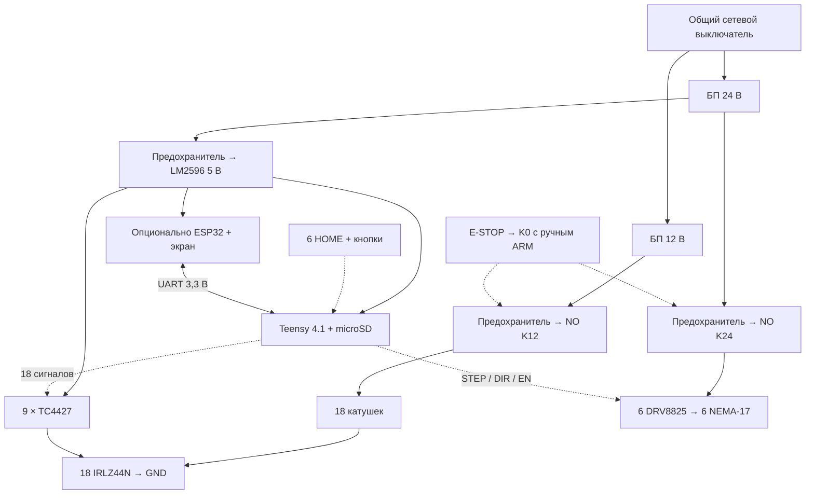

# Электроника робогитары: проект для закупки в России

Редакция: 15 сентября 2026. Проект обновлён под замечания пользователя. Это схема первого прототипа, а не испытанное устройство; прошивка и интерфейс пока не реализованы. Модель гитары, масса кареток, силы и требуемые длительности зажима ещё не измерены.

**Основной вариант: Teensy 4.1 + 6 NEMA-17 + 6 DRV8825 + 18 силовых каналов + 6 HOME.** Питание логики самостоятельное. Сначала испытываем одну струну; полноценную закупку соленоидов подтверждаем измерениями.

[Схема подключения одной струны](single-string-wiring-ru.md).

## 1. Принятые решения

**Teensy 4.1 подходит по предварительной оценке ресурсов:** Cortex-M7 600 МГц, 1 МБ RAM, 42 GPIO на боковых гребёнках, встроенный слот microSD/SDIO. Этого достаточно для проектирования шести осей и 18 катушек с общим таймером и буфером событий. Реальную точность времени проверяем на работающей прошивке; ограничения скорости механики процессор не отменяет. Распознавание произвольного MP3 в гитарную аранжировку в эту оценку не входит. [PJRC](https://www.pjrc.com/store/teensy41.html).

**NEMA-14 заменяем на NEMA-17.** NEMA — размер крепления, а не ток. Нужны новые кронштейны под фланец около 42 мм, проверка расстояния между моторами и диаметра вала. Кандидат 17HS4401: четыре провода, 1,8°, 1,7 А/фазу. Начинаем с ограничения 0,8–1,0 А: момент при этом ниже номинального. При прежних 200 шагах/оборот и шкиве расчёт STEP/мм сохраняется. [Jkongmotor](https://www.jkong-motor.com/sale-11004070-nema17-hybrid-stepper-motor-17hs4401-high-torque-4-2kg-cm-1-7a-40mm-length-for-cnc-router.html).

**DRV8825 оставляем.** Замена нужна только если требуемый ток/момент не обеспечивается без перегрева. Для оригинального Pololu ориентир без дополнительного охлаждения — около 1,5 А/фазу; для клона это не гарантия. Не выставлять номинальные 1,7 А двигателя автоматически. [Pololu](https://www.pololu.com/product/2133).

**Маркировка DRV8825 / 92TC5 / A588:** для функции важна строка DRV8825. Остальные обычно производственные коды; точную расшифровку этих двух строк не подтверждаю. Они сами по себе не требуют замены. Но надпись не подтверждает подлинность, распиновку платы или номинал резисторов тока. Нужен модуль с обвязкой и регулировкой VREF, не одна голая микросхема. [TI](https://www.ti.com/lit/ds/symlink/drv8825.pdf).

**Пружины медиатора не обязательны.** Два соленоида выполняют два рабочих щипка в противоположных направлениях, отдельного холостого возврата нет. Нужно удерживать парковку после снятия тока: двумя выключенными катушками это не обеспечивается.

**Боуден принимаем:** оболочка закреплена на раме у соленоида и на каретке, жила соединяет шток с рычагом. Петля оболочки меняет форму при переезде; усилие и трение измеряем вместе с ней.

## 2. Компоненты: что нужно и почему

Количество — стенд одной струны / шесть струн. Наличие в каталоге РФ не равно наличию полного комплекта на складе. Цены и остатки — отображавшиеся при проверке карточки, не резерв и не подтверждение продавцом. Доступность и техническая пригодность соленоида — разные вопросы.

| Узел | Модель / пример покупки в РФ | Количество | Что требуется и что даёт компонент | Решение |
|---|---|---:|---|---|
| Контроллер | Teensy 4.1 с гребёнками, найденный вами | 1 / 1 | GPIO, быстрый таймер, память, встроенная SD | Оставляем |
| Мотор | NEMA-17 17HS4401, 1,8°, 1,7 А/фазу, 4 провода, вал 5 мм; [iArduino](https://iarduino.ru/shop/Mehanika/shagovyy-dvigatel-42.html), [Arduino54](https://arduino54.ru/catalog/mehanika/shagovye-dvigateli/shagovye-dvigateli-17hs4401-5sht/) | 1 / 6 | Позиционирование каретки; доступный типоразмер | Проверить при токе 0,8–1 А |
| Драйвер мотора | Найденный модуль DRV8825; радиатор/обдув по нагреву | 1 / 6 | STEP/DIR, регулирование тока, микрошаг | Оставляем, проверить Rsense |
| Ключ катушки | IRLZ44N / IRLZ44NPBF Infineon TO-220; [«Электроника»](https://magazin-elektronika.ru/99-46-44), [CHIPSTER](https://chipster.ru/catalog/active-components/transistors/field-effect-transistor/280.html) | 3 / 18 | Коммутирует ток катушки; удобен для пайки | Через драйвер затвора ниже |
| Драйвер затвора | TC4427CPA или TC4427EPA DIP-8; [Битран](https://www.bitran.ru/catalog/?ELEMENT_ID=16977885&SECTION_ID=20835), [Onlinecomponents](https://onlinecomponents.ru/product/9762639/) | 2 / 9 | Два канала: принимает 3,3 В и управляет затвором от 5 В | Поставщики РФ, под заказ; уточнить срок |
| Защитный диод | 1N5822, Schottky 3 А / 40 В, выводной | 3 / 18 | Путь тока катушки после OFF | Для выбранных катушек до 1,5 А; проверить паспорт изготовителя |
| Зажим: испытательный кандидат | JF-1253B, 12 В, 8 Ом, до 1,5 А, ход 10 мм; [iArduino](https://iarduino.ru/shop/Mehanika/solenoid-jf-1253b.html) | 1 / 6 после проверки | Тянет трос; заявлено до 42 Н | Карточка: 1560 ₽, 3 шт. Длительное удержание не подтверждено |
| Щипок: испытательный кандидат | JF-0520B, 12 В, 12 Ом, до 1 А, ход 10 мм; [iArduino](https://iarduino.ru/shop/Mehanika/solenoid-tau-0520.html) | 2 / 12 после проверки | Перемещает лёгкий держатель; заявлено до 4 Н | Карточка: 282 ₽, 22 шт.; проверить силу и пружины |
| Щипок: более сильная альтернатива | JF-0837B; [исполнение iArduino](https://iarduino.ru/shop/Mehanika/solenoid-tau-0837t.html) | Вместо 0520B | Если маленький привод не справится | Здесь до 2 А: пересчитать питание и тепловой режим ключа |
| HOME | Omron D2F-01L, рычажный SPDT для малых токов; [Импульс](https://impulsi.ru/catalog/mikropereklyuchateli/70008572_mikropereklyuchatel_d2f_01_l.html), [Радиоэлемент](https://www.radioelementy.ru/catalog/importnye-radiokomponenty/c0087297/d2f-01l-mikropereklyuchatel-snap-action-s-rychagom-spdt-0-1a-30vdc-omron/) | 1 / 6 | Повторяемый механический ноль; контакты COM/NC | Каталоги РФ, срок уточнить |
| БП катушек | Mean Well GST220A12-R7B: 12 В / 15 А / 180 Вт | 1 / 1 | Питание катушек | Сохраняем условно; расчёт ниже |
| БП моторов | Mean Well GST120A24-R7B: 24 В / 5 А / 120 Вт | 1 / 1 | Моторы через драйверы, питание преобразователя логики | Оставляем, проверить полный режим |
| Питание логики | Модуль LM2596, настроенный на 5,0 В; [iArduino](https://iarduino.ru/shop/Istochniki-pitanija/ponizhayuschiy-dc-dc-preobrazovatel.html) | 1 / 1 | Получаем 5 В из 24 В без ПК | Для начала нагрузка до 1 А; проверка пульсаций/нагрева |
| Песни | microSD 8–32 ГБ FAT32 | 1 / 1 | Песни и калибровки | В слот платы Teensy, не внешний модуль |
| Start/Stop | Кнопка без фиксации с сухим NO-контактом для малых сигналов; тактовая 6×6 мм для стенда | 1 / 1 | Программный запуск/остановка | GPIO40; не силовой выключатель |
| Общий POWER | Готовый закрытый сетевой блок с двухполюсным выключателем 250 В AC, 10–16 А, PE; допустимый пусковой ток двух БП | 1 / 1 | Отключает оба адаптера целиком | Без открытой сетевой проводки на стенде |
| E-STOP | Красный грибок Ø22 мм, фиксация, поворотный сброс, принудительное размыкание NC; пример IEK LAY5-BS542 + совместимый дополнительный NC | 1 / 1 | Аппаратно отключает приводы | Коммутирует катушки реле, не 15 А нагрузки |
| Силовое отключение | K12/K24: реле/контакторы с катушками 12 В DC и NO; отключение ≥20 А при 12 В DC / ≥10 А при 24 В DC соответственно | 1 пара / 1 пара | Разрывают обе положительные силовые шины | Требования для подбора; модель пока не утверждена |
| Разрешение приводов | K0, катушка 12 В DC, минимум 2 NO; кнопка ARM NO и DISARM NC; подавители выбросов катушек реле | 1 комплект / 1 | Самоподхват, ручное включение после аварии | Схема в разделе 9 |
| Интерфейс, этап 2 | [ESP32-WROOM-32 DevKit v1, Амперка](https://amperka.ru/product/esp32-wroom-wifi-devkit-v1) | 0 / 1 | Wi-Fi/Bluetooth, экран, меню | Отдельный интерфейсный контроллер |
| Экран, этап 2 | OLED SSD1306 128×64 I²C с питанием и логикой 3,3 В; [пример семейства Trema OLED](https://wiki.iarduino.ru/page/OLED_trema/) | 0 / 1 | Название песни, состояние, ошибки | Подключать к ESP32; сверить исполнение модуля |
| Кнопки меню | 3 NO-кнопки | 0 / 3 | Назад / вперёд / выбрать | GPIO ESP32 |
| Механика | GT2, шкив 20 зубьев под вал 5 мм, ролик, натяжитель; Боуден; направляющая, упоры и фиксаторы медиатора | 1 / 6 комплектов | Передача движения и устойчивые парковки | Размеры уточнить по макету |

Обвязка ключей: на канал 100 Ом в затвор, 10 кОм затвор–исток, 10 кОм вход TC4427–GND (по 3/18 шт.). На TC4427 — 100 нФ + 1 мкФ (2/9 комплектов). На DRV8825 — 100 мкФ/50 В (1/6 шт.); общий EN — 1 кОм/1%. На HOME — 2,2 кОм подтяжка, 1 кОм последовательно, 10 нФ фильтр (1/6 комплектов). GPIO39/40 — по 4,7 кОм к 3,3 В. Шина 12 В — 1000 мкФ/35 В.

Также нужны предохранители, клеммы, держатели, силовые провода, корпус, крепления и теплоотводы. Разъёмы R7B у БП требуют подходящих ответных частей; это не обычный круглый DC-jack. Силовые токи не проводить через breadboard/Dupont.

Готовая альтернатива ключу — [Trema N-канал](https://iarduino.ru/shop/Expansion-payments/silovoy-klyuch-trema-modul.html). Перед применением проверить конкретную ревизию, управление от 3,3 В при нужном токе, защитный диод и перемычку внешнего питания. Схема ниже использует TC4427 + IRLZ44N, чтобы не зависеть от неизвестной обвязки модуля.

## 3. Общая схема



Все GND объединены на распределителе; силовые обратные токи не идут через Teensy. Плюсы 12/24/5 В не объединять. DC-DC подключён до K24: аварийная кнопка отключает приводы, а логика остаётся включённой.

## 4. Карта GPIO Teensy

Номера — надписи GPIO платы; струна 1 тонкая E4, струна 6 толстая E2.

| Струна | Зажим → IN TC4427 | STEP | DIR | HOME | PICK_A → IN | PICK_B → IN |
|---|---:|---:|---:|---:|---:|---:|
| 1 | 2 | 8 | 14 | 20 | 26 | 27 |
| 2 | 3 | 9 | 15 | 21 | 28 | 29 |
| 3 | 4 | 10 | 16 | 22 | 30 | 31 |
| 4 | 5 | 11 | 17 | 23 | 32 | 33 |
| 5 | 6 | 12 | 18 | 24 | 34 | 35 |
| 6 | 7 | 13 | 19 | 25 | 36 | 37 |

38 — общая EN, 39 — отдельный сухой NC аварийной кнопки, 40 — Start/Stop, 41 — резерв. 0 RX1 / 1 TX1 резервируем под ESP32; USB Serial их не занимает. Всего 37 линий приводов/HOME/EN + 2 кнопки + 2 UART = 41 из 42 боковых GPIO.

GPIO2–7 поддерживают PWM зажимов. GPIO13 занят STEP — не мигать LED. SPI10–13 и I²C18/19 заняты: SD используем встроенную SDIO, экран подключаем к ESP32. Все сигналы Teensy — 3,3 В, входы не допускают 5 В. [Карта PJRC](https://www.pjrc.com/teensy/card11a_rev4_web.pdf).

## 5. DRV8825 и NEMA-17

| Контакт модуля | Подключение |
|---|---|
| VMOT | +24 В после K24 и защиты |
| Оба GND | Общая земля; силовой возврат отдельным проводом |
| A1/A2, B1/B2 | Две обмотки; пары определить омметром при снятом питании |
| STEP / DIR | По карте GPIO |
| RESET и SLEEP | 3,3 В Teensy |
| MODE0 / MODE1 | 3,3 В |
| MODE2 | GND; получается 1/8 |
| EN | GPIO38 + общая подтяжка 1 кОм/1% к 3,3 В |
| FAULT | В минимальном стенде не подключён |

100 мкФ/50 В между VMOT/GND возле каждой платы. HIGH EN выключает мосты. При запуске сначала STEP LOW, EN HIGH, все катушки OFF; силовая цепь до ручного ARM отключена.

Формула DRV8825: `I_limit = VREF / (5 × Rsense)`. При R100=0,10 Ом предел 0,8–1,0 А соответствует VREF=0,40–0,50 В. При другом Rsense пересчитать. Резисторы разных мостов не складывать. 1,7 А мотора — верхняя граница, а не обязательная установка. На меньшем токе проверить момент, разгон, пропуски и нагрев.

Обмотки подключать к 24 В только через токовый драйвер. Мотор не отсоединять под питанием. STEP HIGH/LOW ≥1,9 мкс, DIR setup/hold ≥650 нс, после SLEEP выдержать ≥2 мс. [TI](https://www.ti.com/lit/ds/symlink/drv8825.pdf). Проверить выбросы VMOT при торможении осей: электролит не гарантирует отсутствие перенапряжений.

## 6. Силовой ключ катушки

```text
+12_SAFE → предохранитель ветви → плюс катушки
минус катушки → D IRLZ44N; S → силовой GND
диод параллельно катушке: катод (полоска) к плюсу, анод к минусу

GPIO → IN TC4427; IN → 10 кОм → GND
OUT TC4427 → 100 Ом → G IRLZ44N
G → 10 кОм → S/GND
TC4427 VDD → 5 В логики; GND → общий
```

HIGH включает катушку, LOW выключает. Диод ставить у катушки. Минус катушки не соединять дополнительно с GND: это обходит ключ. Встроенный диод MOSFET не заменяет диод катушки.

TC4427 DIP-8: 1/8 NC (не подключать), 2 IN A, 3 GND, 4 IN B, 5 OUT B, 6 VDD, 7 OUT A. У свободного канала стенда вход заземлить, выход оставить свободным. 100 нФ и 1 мкФ возле 6/3. IRLZ44N Infineon TO-220: при взгляде на маркировку, ножки вниз, 1 G / 2 D / 3 S; металлическая площадка тоже D. Радиаторы разных каналов нельзя соединять без изоляции.

TC4427 принимает HIGH от 2,4 В, выдаёт около 5 В на затвор. IRLZ44N не управляется напрямую от Teensy: его сопротивление при 3,3 В не гарантировано паспортом. [Microchip](https://ww1.microchip.com/downloads/aemDocuments/documents/APID/ProductDocuments/DataSheets/20001422G.pdf), [Infineon](https://www.infineon.com/assets/row/public/documents/24/49/infineon-irlz44n-datasheet-en.pdf).

При 1,5 А и 0,025 Ом статические потери около 0,056 Вт при паспортных условиях; нагрев и переключения увеличат их. Проверить также диод, клеммы и провода. Питание TC4427 от постоянных 5 В сохраняется при E-STOP.

Обратный диод замедляет спад тока. Между выключением одной катушки медиатора и включением другой нужна измеренная пауза. Ускорение через TVS — отдельный расчёт, не просто удаление диода.

## 7. Соленоиды и HOME

### Медиатор

Последовательность: парковка слева → импульс правой катушки → щипок → парковка справа; следующий щипок — обратный переход. Оба штока связаны с держателем на отдельной направляющей. Активный соленоид перемещает держатель и вытягивает обесточенный противоположный шток.

Отдельный пружинный возврат не нужен. Две пружины могут тянуть держатель в середину и вызвать лишний щипок. Но после OFF держатель должен оставаться вне струны: нужны, например, магнитные фиксаторы или механизм с двумя устойчивыми положениями, упоры и отсутствие отскока. Усилие фиксатора входит в нагрузку соленоида. Штатную пружину можно убрать только после проверки удержания штока и конструкции.

Начальная сторона неизвестна: для первого стенда вручную установить медиатор в отмеченную парковку. Не выполнять слепой возврат через струну. Позже можно добавить датчики обеих парковок через расширитель входов — текущая карта и закупка их не включают. После аварии снова UNKNOWN.

Ориентиры поиска, не измеренные требования: 12 В DC, ход держателя примерно 3–6 мм (катушки 5–10 мм), сила на начале рабочего хода порядка 2–5 Н, лёгкий шток, импульсы десятки миллисекунд. Проверить на реальной струне и медиаторе: «до 4 Н» не означает 4 Н на всём ходе.

Начать испытание одиночными импульсами 10–20 мс с паузами несколько секунд и контролем перемещения/нагрева. Это метод подбора, не паспортный режим. При частоте щипков f и чередовании катушек доля включения каждой `D ≈ f × t_on / 2`: 8 щипков/с при 30 мс дают 12%. Допустимость зависит от катушки и теплоотвода.

### Зажим и длительное удержание

Возврат обеспечивают пружины вашей каретки. Нужно не только удержать, но и втянуть трос из исходного положения, преодолевая трение Боудена.

JF-1253B — **испытательный кандидат, а не подтверждённый привод непрерывного удержания**. Продавец указывает 12 В, 1,5 А, 8 Ом, 10 мм, до 42 Н и предупреждает не держать включённым больше минуты. Нет кривой силы по ходу и ED100%. Это не означает, что любое повторение импульсов короче минуты безопасно. [Карточка](https://iarduino.ru/shop/Mehanika/solenoid-jf-1253b.html).

Требования для самостоятельного поиска:
- Тяговый линейный соленоид 12 В; рабочий ход ориентировочно 3–5 мм, полный 5–10 мм.
- Начальный ориентир силы на тросе 10–20 Н; окончательно — измеренный максимум готового механизма с запасом примерно 1,5–2. Это не утверждение, что каждой струне нужны 20 Н.
- Достаточная сила на всём рабочем ходе, особенно в начале; сила удержания при втянутом якоре не заменяет стартовую.
- Для неограниченно длинных нот — паспортный ED100% при указанном охлаждении; для ограниченных выдержек — допустимое время включения, пауза и повторяемость.
- Для сохранения БП15 А желательно до 0,8–0,9 А на зажим в худшем разрешённом сочетании нагрузок.

Измерить динамометром усилие и ход готового троса на 1, 6 и 12 ладах крайних струн до чистого звука. Отдельно задать максимальную длительность удержания и режим повторных нот. Прогретый привод должен сохранять силу.

Возможен режим «полный ток втягивания → пониженный ток удержания PWM». Удерживающий ток определяется измерением; процент PWM не равен проценту силы, нагрев зависит от RMS-тока. PWM сам по себе не превращает катушку в ED100%. Если нужную силу после прогрева получить нельзя, требуется другой соленоид или передаточное отношение.

### HOME: что это

Маленький микропереключатель с металлическим рычажком, фотографии — по ссылкам D2F-01L в таблице. Его крепят на раме у начала пути; выступ каретки нажимает рычаг до жёсткого упора.

COM → GND; NC → узел подтяжки 2,2 кОм к 3,3 В → через 1 кОм к GPIO; 10 нФ между GPIO и GND. NO свободен. Не нажат: LOW; нажат или обрыв: HIGH. Замыкание провода на GND так не выявляется — обязательны таймаут и предел пути.

При HOME: если уже нажат, отойти до отпускания; подъехать, отойти и повторить медленный подъезд. Нет ожидаемого перехода — FAULT. Датчик задаёт механический ноль, не настраивает высоту звука гитары и не обнаруживает пропущенные шаги в середине грифа. [Паспорт Omron](https://static.chipdip.ru/lib/974/DOC056974546.pdf).

## 8. Питание

Оставляем [GST220A12-R7B](https://www.meanwell.com/Upload/PDF/GST220A/GST220A-SPEC.PDF) и [GST120A24-R7B](https://www.meanwell.com/Upload/PDF/GST120A/GST120A-SPEC.PDF), но учитываем новые нагрузки.

Для всех кандидатов на полном токе: `6 × 1,5 + 6 × 1 = 15 А` по 12 В, без служебных цепей. С 30% запасом нужно около 19,5 А. **Прежний БП15 А нельзя безусловно утвердить для этого режима.** На одной струне катушки требуют до 2,5 А — он подходит.

Для сохранения БП задаём целевой бюджет до 11 А катушек плюс цепи реле, проверив остаточный запас. Возможны экономичные зажимы, проверенное снижение удерживающего тока с заранее завершённым втягиванием либо замена БП после измерений. Учитывать и пик одновременного втягивания. Нельзя незаметно разносить аккорд во времени ради экономии тока; неподходящее расписание отклонять.

24 В / 5 А также проверяем при одновременных движениях. Ток фаз не равен входному току БП. В его 120 Вт входит логика: 5 В × 1 А при условном КПД85% — 5,9 Вт, около 0,25 А по 24 В.

Самостоятельное питание: +24 В до K24 → отдельный предохранитель → LM2596 IN+; IN− → GND. До подключения плат выставить 5,0 В и проверить под нагрузкой. OUT+ → VIN Teensy, VDD TC4427 и впоследствии вход 5V/VIN ESP32; OUT− → GND. ESP32 не питать от 3,3 В Teensy. Надпись «3 А» LM2596 не гарантирует длительный ток модуля без охлаждения.

При одновременном USB и внешнем VIN **разделить VIN–VUSB штатными площадками Teensy по инструкции PJRC**, проверить отсутствие проводимости между ними. После этого внешнее питание требуется и при программировании. До разделения два источника одновременно не подключать. [Схема PJRC](https://www.pjrc.com/teensy/schematic.html). У ESP32 также не соединять два источника 5 В без развязки.

Ориентиры короткой проводки: магистраль катушек 2,5 мм², моторов 1 мм², ответвления 0,5 мм²; уточнить по длине/температуре/разъёмам. Начальные предохранители ветвей: зажим 2 А, щипок 1,5 А, вход DRV8825 1 А, вход DC-DC 0,5–1 А; проверить время-токовую характеристику. Главные — в пределах проводки/разъёмов/БП, ориентиры до 15 А и 5 А. Ограничение тока БП может не обеспечить быстрое срабатывание слишком большого предохранителя.

## 9. POWER, STOP и E-STOP

POWER включает оба адаптера готовым закрытым сетевым выключателем. Штатное выключение: STOP → закончить запись SD → DISARM → POWER OFF.

Start/Stop — NO между GPIO40 и GND, подтяжка 4,7 кОм к 3,3 В. Останавливает песню программно; аппаратную аварийную кнопку не заменяет.

E-STOP — фиксируемый красный грибок с NC и поворотным сбросом. Пример IEK LAY5-BS542; для отдельной диагностики нужен дополнительный совместимый NC-блок, он не обязательно входит в комплект. [Каталог IEK](https://www.iek.ru/upload/iblock/bf0/l1sflk31zd3ib7wn6qaecm2630p10x8e/Katalog-Ustroi_stva-podachi-komand-i-signalov.pdf).

Цепь самоподхвата работает независимо от программы:
```text
+12_RAW → предохранитель управления → E-STOP NC → DISARM NC → X
X → [ARM NO параллельно K0.1 NO] → катушка K0 → GND
X → K0.2 NO → [катушка K12 параллельно катушке K24] → GND

+12_RAW → главный предохранитель → силовой NO K12 → +12_SAFE
+24_RAW → главный предохранитель → силовой NO K24 → +24_SAFE
```

Катушки K0/K12/K24 — 12 В DC. Подавители выбросов подобрать к реле; простой диод увеличивает время отпускания. Контакты грибка рассчитаны на ток катушек реле; силовые контакты — на DC-нагрузку и пусковые токи. Надписи «30 А» или «250 VAC» без соответствующей DC-характеристики недостаточно. Модели силовых реле пока не утверждены, спецификация — в таблице.

После E-STOP самоподхват отпадает: отпускание грибка не включает питание, нужен новый ARM. Отдельный NC грибка: COM → GND, NC → GPIO39 с 4,7 кОм к 3,3 В. Этот контакт не связан с цепью 12 В. HIGH → FAULT. Восстановление: устранить причину, сброс ошибки, ARM, известная парковка медиатора, HOME и отдельный PLAY. После пропажи питания также нужны ARM/HOME.

Самоподхват K0 отпадает при потере его питания 12 В. Отдельная потеря только 24 В/5 В не гарантирует его отпускание: после перезапуска Teensy должна оставлять выходы выключенными, требовать DISARM/ARM и HOME. Для аппаратного отключения при потере любой шины добавить реле контроля напряжения с контактом «питание исправно» последовательно в цепь X; в текущем минимальном комплекте такого контроля нет.

Это аппаратная остановка прототипа без резервирования и контроля сваривания контактов. GPIO39 подтверждает состояние кнопки, не контакторов. Энергия конденсаторов/катушек исчезает не мгновенно; измерить задержку остановки. Механика должна безопасно переносить потерю удержания моторов и освобождение зажима.

## 10. Координаты ладов и ограничения скорости

Для мензуры L координата металлического порожка лада n от верхнего порожка:

`x(n) = L × (1 − 2^(−n/12))`.

При L = 650 мм первый лад находится примерно в 36,48 мм, двенадцатый — в 325 мм. Между ними 288,52 мм. Палец нажимает немного перед нужным порожком со стороны головки грифа; фактические координаты пальца для всех 6 × 12 позиций калибруются и хранятся в таблице. Равные шаги между ладами использовать нельзя. Поиск HOME задаёт механический ноль, который не обязан совпадать с верхним порожком.

GT2, 20 зубьев → 40 мм/оборот. Для 200 шагов/оборот и 1/8 микрошагов → 1600 STEP/оборот → **40 STEP/мм**. Дискретность команды 0,025 мм не равна реальной точности: есть люфт, упругость ремня/троса и ошибка исходной позиции.

Иллюстративный профиль, не измеренные характеристики: v = 500 мм/с, a = 5000 мм/с². Частота STEP на ось 20 кГц. Для переезда длиной d из покоя в покой время:

`t_move = 2√(d/a)`, если `d ≤ v²/a`; иначе `t_move = d/v + v/a`.

Для перехода 1→12 получается около 0,677 с; 1→2 — 0,166 с; 11→12 — 0,124 с. Сверху добавляются отпускание, успокоение механики, зажим и время до схода медиатора со струны. Шестнадцатая нота при 120 BPM длится 125 мс: часть переходов не помещается даже в этот условно быстрый профиль. Более высокая частота контроллера сама по себе это не исправит.

После испытаний планировщик должен выбирать другую струну для той же высоты, заранее перемещать свободную каретку, упрощать аранжировку либо снижать темп. Если предыдущую ноту требуется держать до момента следующей на другом ладу той же струны, времени на переезд вообще нет: такой переход надо изменить, а не скрывать задержкой щипка.

## 11. Синхронизация шести струн

Общий источник времени один. Для каждой струны хранятся независимо: текущая позиция, цель, профиль скорости, состояние зажима, сторона медиатора, момент следующего действия. Быстрый цикл посещает все шесть состояний; одно ожидающее устройство не блокирует остальные.

Удобнее разделить состояние пальца и щипкового механизма:

```text
Палец: UNKNOWN → HOMING → RELEASED → MOVING → SETTLING → CLAMPING → HELD
                                           ↑                        │
                                           └─ после RELEASE_WAIT ────┘

Медиатор: PARK_A → импульс B → PARK_B → импульс A → PARK_A
          переход разрешён только после спада тока прежней катушки
Любой узел → FAULT по аварии / таймауту / недопустимой команде
```

Последовательность для новой ноты на другом ладу: выключить зажим, дождаться измеренного отпускания, переместить каретку с разгоном/торможением, дать механике успокоиться, включить зажим, дождаться его готовности, включить нужную катушку медиатора с учётом задержки до звука. Повтор ноты на том же ладу может состоять только из нового щипка; держать зажим во время щипка нормально.

Для требуемого момента начала звука T:

`t_start = T − (t_release + t_move + t_settle + t_clamp + t_pick_latency + запас)`.

Если струна уже свободна/стоит на нужном ладу, соответствующие этапы исключаются. Если она ещё должна держать предыдущую ноту, подготовку нельзя начать раньше её разрешённого освобождения. Задержка `t_pick_latency` измеряется отдельно для обеих сторон и для каждой струны: важен момент схода медиатора, а не момент подачи GPIO. Одновременный аккорд может требовать слегка разных моментов включения катушек, чтобы звук начался одновременно.

Пример только для понимания: отпускание 15 мс, переезд 100 мс, успокоение 10 мс, зажим 25 мс, щипок до начала звука 8 мс. Чтобы звук начался в 1000 мс, начать в 842 мс: отпустить, в 857 начать переезд, в 957 закончить, в 967 включить зажим, в 992 включить медиатор. Другая струна, уже готовая к игре, может получить команду щипка около того же 992 мс. Это условные значения, не паспортные времена выбранных приводов.

**Таймеры:** один `IntervalTimer`, например каждые 10 мкс, обслуживает импульсы всех шести осей. Каждая ось имеет свой накопитель шагов/расписание; не нужен отдельный таймер или процессор на струну. Более медленный слой около 1 мс занимается состояниями и готовит очереди, точные моменты выходов выполняет быстрый слой. Частоты — проектные ориентиры; фактический jitter и нагрузку проверяют логическим анализатором. [PJRC IntervalTimer](https://www.pjrc.com/teensy/td_timing_IntervalTimer.html).

В прерывании не читать SD, не разбирать JSON/MIDI, не печатать USB и не выполнять длительные вычисления. События заранее помещаются в буфер; обмен между главным циклом и прерыванием защищён от частичного обновления. Нужны часы достаточной разрядности либо корректная обработка переполнения. Нельзя строить проигрыватель на цепочках `delay()` или блокирующем ожидании завершения одного двигателя.

Минимальные программные запреты: A и B одной пары не включены вместе; длительность/средняя нагрузка катушки ограничена; зажатую каретку не перемещать; щипок разрешён только при готовности струны; перемещение за пределы калибровки запрещено; пропажа очереди или просроченное событие переводят систему в контролируемую остановку. Watchdog перезапускает зависшую программу, после reset состояние не восстанавливает песню автоматически. Концевик не выявляет пропущенные шаги в середине грифа; для этого нужен энкодер или другой датчик положения.

## 12. Общение с человеком и загрузка песен

**Этап 1 — автономная игра:** файл на microSD в слоте платы Teensy; песня по умолчанию запускается кнопкой после ARM/HOME. Записать карту можно картридером. Извлекать только после остановки записи и выключения. ПК нужен для разработки прошивки и первоначальной подготовки песни, но не для питания и тайминга игры.

**Этап 2 — Wi-Fi и экран:** ESP32-WROOM-32 DevKit v1 принимает файл с телефона через страницу своей точки доступа и передаёт Teensy по UART. Bluetooth можно добавить позже. Экран и кнопки меню подключены к ESP32. У Teensy встроенных Wi-Fi/Bluetooth нет. [Espressif](https://documentation.espressif.com/esp-dev-kits/en/latest/esp32/esp32-devkitc/user_guide.html).

Разводка для ESP32-WROOM (не WROVER): Teensy GPIO1 TX1 → ESP32 GPIO16 RX; ESP32 GPIO17 TX → Teensy GPIO0 RX1; общая GND, уровни 3,3 В. OLED I²C: GPIO21 SDA / GPIO22 SCL ESP32, питание подходящего модуля 3,3 В, подтяжки только к 3,3 В. Кнопки назад/вперёд/выбрать: ESP32 GPIO25/26/27 → GND с подтяжками. ESP32 питается через вход 5V/VIN от общего DC-DC.

Карту обслуживает только Teensy: ESP32 к контактам той же SD не подключается. Загрузка при STOP: временный файл → проверка размера/CRC/содержания → завершение записи и переименование. Команды LIST, SELECT, HOME, PLAY, STOP, STATUS. Проверки безопасности выполняет Teensy. Обрыв связи не запускает движение; после загрузки Wi-Fi для игры не нужен.

Это реализуемая архитектура, но прошивки ещё предстоит написать. Подготовленная таблица и ограниченный MIDI могут обрабатываться на устройстве; распознавание произвольного MP3 остаётся отдельной задачей.

Лучший исходный формат первой версии — таблица «момент щипка, струна, лад, длительность удержания зажима, сила щипка». Табулатура уже содержит струну/лад. MIDI содержит высоту и время, но обычно не содержит нужной аппликатуры: одну высоту можно сыграть несколькими способами. Конвертер должен учитывать строй, диапазон 0–12, максимум одну звучащую высоту на струне, время переезда, перекрытие нот и возможности глушения. Меняющийся темп MIDI также переводится в абсолютные времена. MP3/WAV не являются готовыми командами роботу: их распознавание и аранжировка — отдельный этап.

Стандартный строй для назначения MIDI: струны 6→1 имеют номера открытых нот `[40,45,50,55,59,64]`; номер ноты на ладу n равен номеру открытой плюс n. Для каждого файла строй явно записывается, гитара настраивается перед проигрыванием.

Пример предлагаемого формата, а не существующего протокола прошивки:

```json
{
  "version": 1,
  "tuning_midi_6_to_1": [40, 45, 50, 55, 59, 64],
  "notes": [
    {"pluck_ms": 1000, "string": 6, "fret": 3, "clamp_hold_ms": 500, "velocity": 70},
    {"pluck_ms": 1000, "string": 3, "fret": 0, "clamp_hold_ms": 0, "velocity": 60},
    {"pluck_ms": 1125, "string": 2, "fret": 1, "clamp_hold_ms": 600, "velocity": 65}
  ]
}
```

`clamp_hold_ms` описывает механическое удержание после щипка, не гарантированную акустическую длительность. Значение velocity пока выбирает откалиброванный профиль щипка; оно не обязано линейно соответствовать PWM или громкости.

По USB сначала передавать весь файл, проверять длину/контрольную сумму и получать подтверждение, затем отдельно запускать. Имена команд можно принять `UPLOAD`, `VALIDATE`, `HOME`, `PLAY`, `STOP`, `STATUS`. Не полагаться на то, что Windows будет вовремя присылать отдельные щипки. Прямой live MIDI без предварительного знания следующей ноты потребует заметного буфера/задержки или ограниченного набора переходов.

## 13. Порядок испытаний

1. Без гитары и нагрузки проверить уровни управления, состояние OFF при reset, аппаратное отключение и правильность полярности.
2. Собрать одну ось с её реальным ремнём, кареткой и Боуденом. Проверить направление, HOME, программные пределы, ограничение тока и повторяемость возврата.
3. Измерить на гитаре требуемые силы/ход зажима, подобрать мягкую контактную накладку и рабочие координаты. Проверить нагрев при долгом удержании.
4. Собрать одну пару медиатора. Подтвердить один чистый щипок в каждом направлении и отсутствие случайного щипка/касания при снятии питания.
5. Измерить времена отпускания, движения, успокоения, зажима и щипка; получить допустимые профили и импульсы. Проверить задержки при прогретых катушках и в крайних положениях троса.
6. Исполнить короткую последовательность на одной струне, включая повтор на том же ладу и переход на открытую. Зафиксировать ограничения глушения.
7. После этого закупать остальные пять комплектов; проверить одновременные движения/щипки, просадку питания, шум и нагрев полного набора.

Для учебного стенда одной струны с уже имеющимся Uno R3 возможны: STEP D2, DIR D3, зажим D5, PICK_A D6, PICK_B D7, HOME D8, EN D9. Остальная схема драйверов и внешнего питания аналогична, но логические подтяжки в этой версии к 5 В Uno; это отдельный вариант, не смешивать его с GPIO Teensy. Перенос на основную карту выводов выполняется при переходе на шесть струн.

## 14. Условия утверждения полной закупки

Проверить каретку с Боуденом и NEMA-17, силу/ход/нагрев зажима при максимальной выдержке, оба направления щипка и устойчивость парковок при OFF/reset/E-STOP. Затем измерить ток при одновременном втягивании и аккорде, тайминги шести осей и шум. Не закупать катушки только по названию: у разных продавцов бывают разные обмотки.

Отпустить зажим не значит заглушить звук: может прозвучать открытая нота. Исходные 18 катушек не дают точный Note Off. Нужны демпферы или проверенное положение мягкого касания пальца; ещё шесть демпферов потребуют дополнительных ключей, GPIO и пересчёта питания.

Минимум на сейчас: один NEMA-17, один DRV8825, один JF-1253B и два JF-0520B как испытательные образцы, три ключа и HOME плюс питание/защита. Для окончательного зажима нужны измеренные сила, ход и длительность удержания; доступный вариант с подтверждённым ED100% пока не найден.
