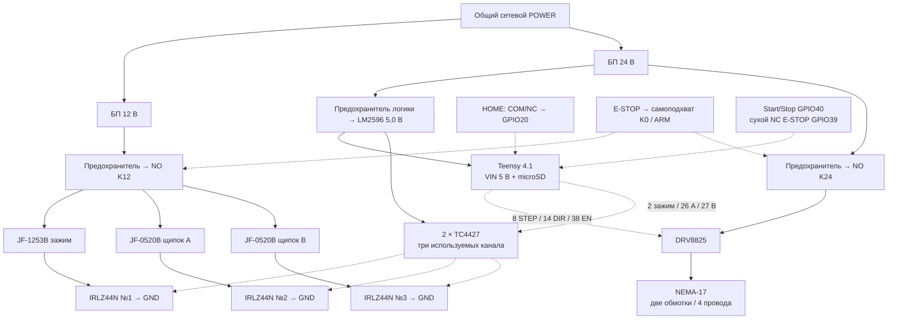

# Одна струна: подключение и принцип работы

Редакция 15 сентября 2026. Согласовано с [общим проектом и таблицей компонентов](electronics-design-ru.md). Прошивка ещё не реализована. Соленоиды — кандидаты для стенда, их сила, нагрев и длительное удержание требуют проверки.

Комплект: Teensy 4.1, NEMA-17 17HS4401, модуль DRV8825, зажим JF-1253B 12 В/1,5 А, два JF-0520B 12 В/1 А, три IRLZ44N, два TC4427 DIP-8, три диода 1N5822 и один HOME D2F-01L.

## Схема



K12/K24 — силовые реле/контакторы, а не контакты маленькой кнопки. Полная цепь K0, ARM и DISARM приведена в разделе 9 общего проекта. Для стенда также требуется аппаратное снятие обеих силовых шин.

Общая GND соединяет минусы источников, Teensy, TC4427, истоки MOSFET и DRV8825. Силовые возвраты — отдельными проводами в распределитель. Плюсы 12/24/5 В не соединять.

## Питание без компьютера

24 В **до K24** → предохранитель → LM2596 IN+/IN−. Настроить OUT на 5,0 В мультиметром до подключения плат, затем проверить под нагрузкой. OUT+ → VIN Teensy и VDD TC4427; OUT− → GND.

При внешнем VIN и подключении USB к ПК разделить штатные площадки VIN–VUSB по [инструкции PJRC](https://www.pjrc.com/teensy/schematic.html) и проверить разрыв. После этого питание при программировании тоже внешнее. До разделения не подключать одновременно внешние 5 В и USB.

microSD вставляется прямо в слот **платы Teensy 4.1**. Проигрывание подготовленной песни с карты и кнопкой не требует ПК. Прошивку и загрузчик ещё нужно написать.

Для выбранных катушек одна струна потребляет до 2,5 А по 12 В, не считая служебных цепей. На шести струнах полный ток достигает 15 А без запаса; ограничения сохранения прежнего БП описаны в общем проекте.

## DRV8825

| Вывод | Куда |
|---|---|
| VMOT | +24_SAFE после K24 и защиты |
| GND, оба | Общая земля |
| A1/A2 | Одна обмотка 17HS4401 |
| B1/B2 | Вторая обмотка |
| STEP / DIR | GPIO8 / GPIO14 |
| EN | GPIO38; резистор 1 кОм/1% к 3,3 В |
| RESET / SLEEP | 3,3 В |
| MODE0 / MODE1 | 3,3 В |
| MODE2 | GND, микрошаг 1/8 |
| FAULT | Не подключать в минимальном стенде |

100 мкФ/50 В непосредственно между VMOT/GND, плюс к VMOT. Пары обмоток определить омметром, не полагаться на цвет проводов разных производителей. Не подключать мотор под питанием.

Начальный предел 0,8–1 А, а не автоматически 1,7 А. Формула `I_limit = VREF / (5 × Rsense)`; только при Rsense=0,10 Ом это VREF=0,40–0,50 В. Сначала проверить резисторы конкретного модуля. NEMA-17 требует нового крепления, но не обязательно другого драйвера. [TI DRV8825](https://www.ti.com/lit/ds/symlink/drv8825.pdf), [Pololu](https://www.pololu.com/product/2133).

## Три канала катушек

```text
+12_SAFE → предохранитель ветви → катушка → D MOSFET
                                               S → силовой GND
диод поперёк катушки: катод/полоска к плюсу, анод к D

GPIO → IN TC4427; IN → 10 кОм → GND
OUT → 100 Ом → G MOSFET; G → 10 кОм → S
```

Диод 1N5822 ставить возле катушки. Минус катушки не соединять с землёй дополнительно. На шине 12_SAFE поставить 1000 мкФ/35 В, плюс к плюсу.

Пример распределения двух TC4427 (вид сверху, номера по ключу корпуса):

| Микросхема/вывод | Назначение |
|---|---|
| U1 pin2 IN A | GPIO2, зажим |
| U1 pin7 OUT A | Через 100 Ом к G ключа зажима |
| U1 pin4 IN B | GPIO26, щипок A |
| U1 pin5 OUT B | Через 100 Ом к G ключа A |
| U2 pin2 IN A | GPIO27, щипок B |
| U2 pin7 OUT A | Через 100 Ом к G ключа B |
| U2 pin4 IN B | GND, неиспользуемый вход |
| U2 pin5 OUT B | Свободен |
| Оба: pin6 / pin3 | 5 В / GND; 100 нФ + 1 мкФ рядом |
| Оба: pin1 / pin8 | Не подключать |

IRLZ44N Infineon TO-220, надпись к себе, ножки вниз: 1 G, 2 D, 3 S. Металлическая площадка — D. TC4427 нужен для надёжного управления затвором 5 В от сигнала Teensy 3,3 В. Выход TC4427 обратно к GPIO не подключать. [Microchip](https://ww1.microchip.com/downloads/aemDocuments/documents/APID/ProductDocuments/DataSheets/20001422G.pdf), [Infineon](https://www.infineon.com/assets/row/public/documents/24/49/infineon-irlz44n-datasheet-en.pdf).

## HOME и кнопки

HOME — маленький переключатель с рычажком на раме у начала пути. Выступ каретки нажимает его до жёсткого упора. Это датчик механического нуля, не датчик музыкального строя.

```text
3,3 В → 2,2 кОм → узел H → 1 кОм → GPIO20
                   │                  │
                   NC                10 нФ
                   COM → GND          │
                                     GND
```

Не нажат — LOW, нажат или провод оборван — HIGH. NO не используется. Во время HOME нужны проверка отпускания/повторного срабатывания, предел пути и таймаут.

Start/Stop: GPIO40 → NO-кнопка → GND; подтяжка 4,7 кОм к 3,3 В. GPIO39 — только отдельный сухой NC аварийного грибка, тоже с 4,7 кОм к 3,3 В. На эти контакты не подавать 12/24 В.

## Как получается нота

1. Включить POWER: логика загрузится с катушками OFF и EN HIGH. Вручную установить медиатор в известную парковку вне струны. Включить ARM.
2. HOME: при необходимости отойти от нажатого концевика, подъехать, отойти и повторить медленный подъезд. Запомнить механический ноль.
3. При поднятом пальце послать STEP/DIR и переместить каретку к откалиброванному ладу; дождаться остановки и успокоения.
4. Включить ключ зажима GPIO2. Соленоид втянет трос Боудена и прижмёт палец; выдержать измеренное время готовности.
5. Коротко включить A или B в зависимости от парковки. Держатель пересекает струну один раз и остаётся на другой стороне. Катушку выключить.
6. Следующая нота на том же ладу — щипок в обратную сторону. Для другого лада сначала отпустить зажим и дождаться поднятия пальца; для открытой струны палец поднят, ехать к нулю не нужно.

У зажима возврат обеспечивают пружины каретки. У медиатора отдельный холостой возврат не нужен: пружины катушек не должны тянуть его обратно через струну. Нужны направляющая, упоры и фиксаторы парковок; две выключенные катушки сами держатель не фиксируют. Проверить отскок и поведение при OFF/E-STOP.

JF-1253B не имеет подтверждения непрерывного удержания в найденной карточке: продавец предупреждает о перегреве. Силу на тросе, допустимое время и нагрев сначала измерить; не считать заявленные «42 Н» силой на всём ходе. [JF-1253B](https://iarduino.ru/shop/Mehanika/solenoid-jf-1253b.html).

## Проверка и развитие

До установки на гитару проверить OFF при reset, аппаратный E-STOP, отсутствие автоматического включения после его сброса, полярность и ограничение тока. Затем проверить движение, силы, нагрев, один щипок за команду и устойчивые парковки. Между катушками A/B нужна пауза для спада тока; одновременно их не включать.

После аварии: устранить причину, сброс ошибки, ARM, известная парковка, HOME, отдельный PLAY. Снятие питания не мгновенно снимает ток катушек и удержание; механика должна безопасно переносить остановку.

Для Wi-Fi и экрана позднее добавить ESP32 по свободному UART Teensy GPIO0/1. Экран/меню подключаются к ESP32; контакты I²C Teensy уже заняты. Подробная разводка и загрузка файлов — в разделе 12 общего проекта.

Отпустить палец не значит точно заглушить звук. Для точного окончания нот потребуется проверенное глушение, отдельные демпферы пока не включены.
