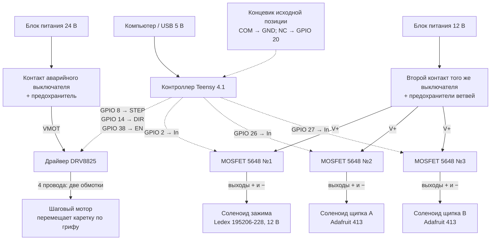

# Одна струна: схема подключения и принцип работы

Упрощённая схема стенда из [проекта электроники](electronics-design-ru.md): Teensy 4.1, один шаговый мотор SOYO SY35ST36-1004A / Pololu 1209 с драйвером Pololu DRV8825, три соленоида с отдельными MOSFET-платами Adafruit 5648 и один концевик. Это предлагаемая схема, а не отчёт об испытанном устройстве; прошивка пока не реализована.

Номера GPIO соответствуют первой струне в общей карте проекта. Сплошные стрелки показывают питание и подключения приводов, пунктирные — управляющие сигналы. Общая земля и вспомогательные соединения приведены под схемой.

## Питание и дополнительные соединения

Для стенда в проекте предусмотрены лабораторные источники 12 В / 3 А и 24 В / 1 А с ограничением тока. Teensy питается через USB. Аварийный выключатель одновременно разрывает обе положительные силовые шины; его контакты должны быть рассчитаны на соответствующий постоянный ток. Подробные требования к защите и проводке приведены в разделе 9 проекта электроники.

**Общая земля:** минусы обоих блоков питания, GND Teensy и GND всех драйверов соединяются на общем распределителе. Силовые токи возвращаются туда отдельными проводами, не через Teensy. **Плюсы 12 В, 24 В и USB между собой не соединяются.** На GPIO Teensy допускаются только логические уровни 3,3 В.

| Узел | Подключение |
|---|---|
| DRV8825: RESET и SLEEP | К 3,3 В Teensy |
| DRV8825: MODE0 и MODE1 | К 3,3 В |
| DRV8825: MODE2 | К GND; вместе с MODE0/1 получается микрошаг 1/8 |
| DRV8825: EN / ENBL | GPIO 38 и резистор 1 кОм к 3,3 В; LOW включает драйвер, HIGH выключает |
| DRV8825: питание | 100 мкФ / 50 В между VMOT и GND рядом с платой, плюсом к VMOT; оба GND платы подключить к общей земле |
| DRV8825: FAULT | В минимальном стенде не подключать |
| Мотор | Одна обмотка к A1–A2, другая к B1–B2; пары проверить омметром при снятом питании |
| Каждая плата 5648 | V+ к 12 В через предохранитель ветви, GND к общей земле, In к своему GPIO; резистор 10 кОм между In и GND |
| Шина 12 В | 1000 мкФ / 35 В между защищённой шиной +12 В и GND, плюсом к +12 В |
| Концевик | COM к GND, NC к GPIO 20; резистор 2,2 кОм между GPIO 20 и 3,3 В |

Катушка каждого соленоида подключается **между выходными клеммами «+» и «−» своей платы 5648**. Выходной «−» нельзя дополнительно соединять с GND: именно этот провод коммутирует MOSFET. HIGH на In включает катушку, LOW выключает. Плата содержит защитный диод для индуктивной нагрузки. См. [распиновку Adafruit](https://learn.adafruit.com/adafruit-mosfet-driver/pinouts) и [описание платы 5648](https://www.adafruit.com/product/5648).

Перед запуском настроить ограничение тока DRV8825 под двигатель. Для выбранного оригинального Pololu начать с VREF = 0,30–0,40 В, то есть предела 0,6–0,8 А; для мотора на 1 А не превышать VREF = 0,50 В. Эта зависимость относится к указанной плате, для клона нужна проверка измерительных резисторов. Мотор подключать и отключать только при снятом питании. См. [инструкцию Pololu](https://www.pololu.com/product/2133).

## Как работает одна нота

1. **Поиск исходной позиции.** Контроллер медленно перемещает каретку до концевика, отходит и повторяет медленный подъезд, затем запоминает механический ноль. В обычном положении NC замкнут на землю; при срабатывании контакт размыкается и подтяжка даёт HIGH на GPIO 20. Обрыв провода также даёт HIGH, поэтому программа должна проверять изменение состояния и ограничивать время поиска.
2. **Выбор лада.** При поднятом пальце Teensy задаёт направление сигналом DIR и посылает импульсы STEP. Драйвер управляет током обмоток, а мотор через ремень перемещает каретку. После поиска нуля контроллер считает импульсы и использует откалиброванные координаты ладов; концевик не обнаруживает пропущенные шаги в середине грифа.
3. **Зажим струны.** После остановки и успокоения каретки GPIO 2 включает первый MOSFET. Соленоид получает ток от источника 12 В, тянет трос в оболочке Боудена и прижимает палец к струне. Возврат пальца после выключения обеспечивает механика.
4. **Щипок.** После готовности зажима контроллер коротко включает соленоид A либо B, который проводит медиатор через струну. Катушки щипка не включаются одновременно; перед включением противоположной нужно дождаться спада тока предыдущей. Длительности импульсов и паузы определяются испытаниями.
5. **Следующая нота.** Для другого лада сначала отпустить зажим и дождаться поднятия пальца, затем переместить каретку. Для повторной ноты на том же ладу достаточно нового щипка. Для открытой струны палец остаётся поднятым, возвращаться к началу грифа не нужно.

Teensy задаёт последовательность и время, а драйверы подают необходимый ток на приводы. Компьютер заранее передаёт подготовленную последовательность; точные моменты движения и щипка должен выдерживать контроллер.

Механизм медиатора ещё нужно испытать: возврат пружины не должен давать лишний щипок, а крайние положения должны быть устойчивыми. Непрерывное включение Adafruit 413 в этом варианте не предусмотрено. Отпускание зажима само по себе не гарантирует глушение звука; для точного окончания нот потребуется проверенный способ демпфирования.
