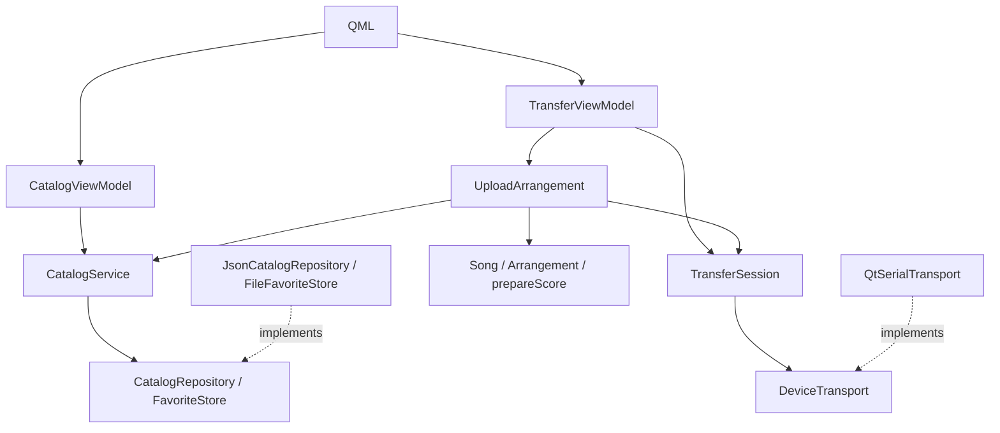

# Архитектура приложения

В приложении разделены музыкальные данные, сценарии работы, адаптеры внешних
систем и представление для Qt Quick. Точка сборки всех объектов —
[`desktop/src/main.cpp`](../desktop/src/main.cpp).

## Каталоги и зависимости

| Каталог | Ответственность | Зависимости |
|---|---|---|
| `core/domain` | Песни, аранжировки, длительность, струны, подготовка темпа | Стандартная библиотека C++, общий формат нот |
| `core/application` | Каталог, избранное, сценарий загрузки, состояние передачи, интерфейсы внешних систем | Музыкальная модель и абстрактные порты |
| `desktop/src/adapters` | JSON, атомарное сохранение избранного, QSerialPort и таймеры транспорта | Интерфейсы ядра и Qt |
| `desktop/src/presentation` | Свойства и действия, доступные QML | Сценарии ядра и Qt Core |
| `desktop/qml` | Компоновка, оформление, отображение состояния и действия пользователя | Модели представления |

`guitar_core` — самостоятельная библиотека без Qt. Её можно собрать и проверить
с `-DGUITAR_BUILD_APP=OFF`. `guitar_desktop` добавляет Qt-адаптеры и модели
представления. Исполняемый файл `SelfGuitar` связывает их с QML и ресурсами.



## Музыкальная модель

`Song` содержит название и автора. `Arrangement` ссылается на песню через `songId`
и хранит ноты, базовый темп и описание версии. Несколько аранжировок могут
относиться к одной песне. Отображаемые цвета и значки хранятся отдельно от
музыкальных правил в метаданных каталога.

`usedStrings` и `durationMs` вычисляют характеристики аранжировки.
`prepareScore` создаёт отдельную последовательность с выбранным темпом,
сохраняя исходные ноты. Здесь нет QObject, QVariant, чтения JSON и работы с портом.

Каталог не ограничен размером памяти Uno. Проверка вместимости устройства
выполняется при передаче. Текущая модель нот по-прежнему последовательная,
с длительностью 50–10000 мс; аккорды и паузы ещё не добавлены.

## Сценарии

`CatalogService` получает данные через `CatalogRepository`, проверяет уникальность
ID, правильность нот и ссылки на песни. Избранное хранится по ID аранжировки
через `FavoriteStore`. `reload()` возвращает результат загрузки каталога:
сбой избранного не скрывает песни и не делает эту операцию неуспешной.
`catalogError` и `favoritesError` независимы; сохранение избранного не очищает
ошибку каталога. Неудачная загрузка каталога сохраняет предыдущие данные,
а сбой чтения избранного — последний известный набор ID. Если прочитать его
ещё ни разу не удалось, перед изменением сервис повторяет чтение, чтобы
не затереть сохранённые ID пустым набором.

Сервис синхронно уведомляет подписчиков об обновлении данных, избранного
или ошибок. Данные уже обновлены к моменту вызова подписчика. Каждая подписка
имеет собственный идентификатор; удаление одной не отключает остальные.

`UploadArrangement` находит аранжировку по ID, подготавливает последовательность
с выбранным темпом и передаёт её в `TransferSession`.

`TransferSession` — обычный C++-объект. Он отвечает за handshake, очередь нот,
ожидаемые подтверждения, CRC, прогресс, отмену и ошибки. USB-устройство подставляется
через интерфейс `DeviceTransport`, поэтому сценарий проверяется без платы.

```text
Disconnected → Connecting → Ready → Uploading → Ready
                    ошибка / отмена → Disconnected
```

`Loaded` устанавливается только после `OK END`. Неожиданный перезапуск платы,
обрыв связи или неверное подтверждение сбрасывают текущую передачу. Отмена
закрывает соединение, как в предыдущей реализации протокола. После уведомления
о `Connecting` сессия проверяет номер попытки подключения: если обработчик
отменил её или начал новую, прежняя попытка больше не откроет порт.

## Хранение избранного

`FileFavoriteStore` хранит версию формата и набор ID в `favorites.json`
каталога `QStandardPaths::AppConfigLocation`. Запись через `QSaveFile`
заменяет файл атомарно; прямая перезапись отключена. `save()` либо фиксирует
полный набор, либо сообщает ошибку без отложенной записи. Сервис обновляет
свой набор только после успешного сохранения. Следующая попытка записи
не наследует состояние ошибки предыдущей.

Пока JSON-файла нет, адаптер читает прежний ключ `favorites` из `QSettings`.
Первое успешное изменение сохраняет полученный набор в новом формате;
последующие чтения используют JSON. Старые настройки не изменяются.
Ошибка разбора существующего JSON не вызывает откат к старым настройкам.

## Qt и интерфейс

`CatalogViewModel` предоставляет QML список метаданных аранжировок, выбор,
поиск без учёта регистра, фильтр по струнам и избранное. Карточки выбираются
по стабильному ID; индексы отфильтрованного списка не используются как ID.
QVariantMap и QVariantList существуют только на этой границе с QML.
Модель подписана на сервис, поэтому обновления из любого вызывающего кода
попадают в интерфейс. После `reload()` выбор сохраняется по ID; если выбранная
аранжировка исчезла, выбирается первая доступная либо выбор очищается.
Обновление метаданных того же ID не сбрасывает выбранный пользователем темп.

`TransferViewModel` предоставляет порты, состояние подключения, прогресс,
сообщения на русском и команды подключения/загрузки/отмены. Он передаёт
запрос на загрузку сценарию `UploadArrangement`.

В QML доступны два объекта: `catalog` и `transfer`. QML форматирует отображаемое
время и управляет компоновкой, но не разбирает JSON, не считает CRC и не формирует
команды Arduino. Изменение прогресса не пересоздаёт список песен: у каталога
и сессии отдельные уведомления.

## Владение и выполнение

`main.cpp` создаёт хранилища и транспорт раньше использующих их объектов,
а движок QML — после моделей представления. При завершении порядок обратный.
Ссылки в конструкторах — невладеющие; объекты-зависимости должны жить дольше
пользователей. Сессия отписывается от транспорта в деструкторе, а модель
передачи — от уведомлений сессии. Модель каталога удаляет свою подписку
из сервиса в деструкторе.

Сейчас все callbacks выполняются в потоке приложения. `QSerialPort` и `QTimer`
работают через цикл событий, без блокирующего ожидания ответа. Для будущего
рабочего потока потребуется явная доставка событий в поток GUI.

## Граница текущего этапа

Протокол v1 и прошивка сохранены: до 96 нот, режим DRYRUN, без управления
механикой. Буферное потоковое проигрывание, о котором договорились для Uno,
ещё не реализовано. Для него следующим этапом меняются сценарий/протокол
и прошивка; каталог и интерфейс не должны узнавать о деталях USB-пакетов.

Проверки: `catalog_domain`, `transfer_session` — без Qt и Arduino;
`qt_presentation` — настоящий QML с подставным транспортом, проверкой
поиска/фильтров, выбора по ID, перезагрузки и опустошения каталога,
избранного, восстановления записи после ошибки и загрузки.
Существующие `score_protocol` и `firmware_parser` проверяют общий формат
и обработчик команд платы.
