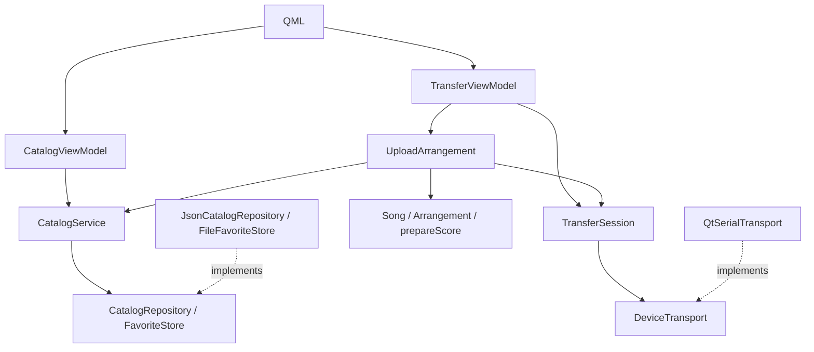

# Архитектура приложения

В приложении разделены музыкальные данные, сценарии работы, адаптеры внешних
систем и представление для Qt Quick. Точка сборки всех объектов —
[`desktop/src/main.cpp`](../desktop/src/main.cpp).

## Каталоги и зависимости

| Каталог | Ответственность | Зависимости |
|---|---|---|
| `core/domain` | Песни, аранжировки, длительность, струны, подготовка темпа | Стандартная библиотека C++, общий формат нот |
| `core/application` | Каталог, избранное, сценарий загрузки, состояние передачи, интерфейсы внешних систем | Музыкальная модель и абстрактные порты |
| `desktop/src/adapters` | JSON, атомарное сохранение избранного, QSerialPort и таймеры транспорта | Интерфейсы ядра и Qt |
| `desktop/src/presentation` | Свойства и действия, доступные QML | Сценарии ядра и Qt Core |
| `desktop/qml` | Компоновка, оформление, отображение состояния и действия пользователя | Модели представления |

`guitar_core` — самостоятельная библиотека без Qt. Её можно собрать и проверить
с `-DGUITAR_BUILD_APP=OFF`. `guitar_desktop` добавляет Qt-адаптеры и модели
представления. Исполняемый файл `SelfGuitar` связывает их с QML и ресурсами.
`guitar_firmware` — отдельная библиотека переносимой логики прошивки; она также
собирается CMake и проверяется на компьютере без Arduino.



## Музыкальная модель

`Song` содержит название и автора. `Arrangement` ссылается на песню через `songId`
и хранит ноты, базовый темп и описание версии. Несколько аранжировок могут
относиться к одной песне. Отображаемые цвета и значки хранятся отдельно от
музыкальных правил в метаданных каталога.

`usedStrings` и `durationMs` вычисляют характеристики аранжировки.
`prepareScore` создаёт отдельную последовательность с выбранным темпом,
сохраняя исходные ноты. Здесь нет QObject, QVariant, чтения JSON и работы с портом.

Каталог не ограничен размером памяти Uno. Проверка вместимости устройства
выполняется при передаче. Текущая модель нот по-прежнему последовательная,
с длительностью 50–10000 мс; аккорды и паузы ещё не добавлены.

## Сценарии

`CatalogService` получает данные через `CatalogRepository`, проверяет уникальность
ID, правильность нот и ссылки на песни. Избранное хранится по ID аранжировки
через `FavoriteStore`. `reload()` возвращает результат загрузки каталога:
сбой избранного не скрывает песни и не делает эту операцию неуспешной.
`catalogError` и `favoritesError` независимы; сохранение избранного не очищает
ошибку каталога. Неудачная загрузка каталога сохраняет предыдущие данные,
а сбой чтения избранного — последний известный набор ID. Если прочитать его
ещё ни разу не удалось, перед изменением сервис повторяет чтение, чтобы
не затереть сохранённые ID пустым набором.

Сервис синхронно уведомляет подписчиков об обновлении данных, избранного
или ошибок. Данные уже обновлены к моменту вызова подписчика. Каждая подписка
имеет собственный идентификатор; удаление одной не отключает остальные.

`UploadArrangement` находит аранжировку по ID, подготавливает последовательность
с выбранным темпом и передаёт её в `TransferSession`.

`TransferSession` — обычный C++-объект. Он отвечает за handshake, очередь нот,
ожидаемые подтверждения, CRC, прогресс, отмену и ошибки. USB-устройство подставляется
через интерфейс `DeviceTransport`, поэтому сценарий проверяется без платы.

```text
Disconnected → Connecting → Ready → Uploading → Ready
                              Ready → Starting → Playing → Ready
                                           Playing → Stopping → Ready
                    ошибка / отмена → Disconnected
```

`Loaded` устанавливается только после `OK END`. Неожиданный перезапуск платы,
обрыв связи или неверное подтверждение сбрасывают текущую передачу. Отмена
загрузки закрывает соединение. Остановка исполнения посылает STOP и ждёт
подтверждения; запрос отключения во время исполнения закрывает порт после него.
После уведомления
о `Connecting` сессия проверяет номер попытки подключения: если обработчик
отменил её или начал новую, прежняя попытка больше не откроет порт.

## Хранение избранного

`FileFavoriteStore` хранит версию формата и набор ID в `favorites.json`
каталога `QStandardPaths::AppConfigLocation`. Запись через `QSaveFile`
заменяет файл атомарно; прямая перезапись отключена. `save()` либо фиксирует
полный набор, либо сообщает ошибку без отложенной записи. Сервис обновляет
свой набор только после успешного сохранения. Следующая попытка записи
не наследует состояние ошибки предыдущей.

Пока JSON-файла нет, адаптер читает прежний ключ `favorites` из `QSettings`.
Первое успешное изменение сохраняет полученный набор в новом формате;
последующие чтения используют JSON. Старые настройки не изменяются.
Ошибка разбора существующего JSON не вызывает откат к старым настройкам.

## Qt и интерфейс

`CatalogViewModel` предоставляет QML список метаданных аранжировок, выбор,
поиск без учёта регистра, фильтр по струнам и избранное. Карточки выбираются
по стабильному ID; индексы отфильтрованного списка не используются как ID.
QVariantMap и QVariantList существуют только на этой границе с QML.
Модель подписана на сервис, поэтому обновления из любого вызывающего кода
попадают в интерфейс. После `reload()` выбор сохраняется по ID; если выбранная
аранжировка исчезла, выбирается первая доступная либо выбор очищается.
Обновление метаданных того же ID не сбрасывает выбранный пользователем темп.

`TransferViewModel` предоставляет порты, состояние подключения, прогресс,
сообщения на русском и команды подключения/загрузки/отмены. Он передаёт
запрос на загрузку сценарию `UploadArrangement`. Команды play/stop направляются
в сессию; режим SIMULATED явно отображается в интерфейсе. Старая прошивка DRYRUN
поддерживает только загрузку, поэтому кнопка исполнения для неё недоступна.

В QML доступны два объекта: `catalog` и `transfer`. QML форматирует отображаемое
время и управляет компоновкой, но не разбирает JSON, не считает CRC и не формирует
команды Arduino. Изменение прогресса не пересоздаёт список песен: у каталога
и сессии отдельные уведомления.

## Владение и выполнение

`main.cpp` создаёт хранилища и транспорт раньше использующих их объектов,
а движок QML — после моделей представления. При завершении порядок обратный.
Ссылки в конструкторах — невладеющие; объекты-зависимости должны жить дольше
пользователей. Сессия отписывается от транспорта в деструкторе, а модель
передачи — от уведомлений сессии. Модель каталога удаляет свою подписку
из сервиса в деструкторе.

Сейчас все callbacks выполняются в потоке приложения. `QSerialPort` и `QTimer`
работают через цикл событий, без блокирующего ожидания ответа. Для будущего
рабочего потока потребуется явная доставка событий в поток GUI.

## Исполнение на контроллере

`firmware/song_receiver/src/main.cpp` соединяет компоненты и обслуживает цикл.
Чтение Serial ограничено 32 байтами за проход, чтобы поступление данных
не вытесняло исполнение. В логике отсутствуют delay и динамические буферы.

| Каталог прошивки | Ответственность |
|---|---|
| `protocol` | Приём строк, загрузка с CRC, PLAY/STOP/STATUS, сообщения о завершении и ошибке |
| `motion` | Преобразование струны и лада в позицию и время подготовки, проверка всей последовательности |
| `playback` | Переходы отпускание → движение → успокоение → зажим → щипок, музыкальные сроки и остановка |
| `hardware` | STEP/DIR, импульсы катушек, банк исполнительных каналов и интерфейс цифровых выходов |
| `config` | Позиции и времена условной машины для симуляции |

`MotionPlanner` и `PlaybackController` используют обычный C++. `DigitalOutput`
задаёт границу с GPIO. По умолчанию подключён `SimulatedOutput`: 24 виртуальные
линии для шести условных струн, по STEP/DIR, зажиму и щипку на каждую.
Это модель исполнения, а не назначение физических выводов и не окончательная
механика медиатора. `ArduinoOutput` — отдельный адаптер GPIO, который в текущем
main не создаётся. Замена адаптера сама по себе не делает профиль аппаратным.

Текущий профиль включает только первую, самую тонкую струну E4. Маска доступных
струн передаётся в READY; интерфейс учитывает именно номера используемых струн,
а не только их количество. Ядро блокирует несовместимую загрузку до BEGIN,
приёмник дополнительно проверяет каждый NOTE. Многострунная симуляция доступна
тестам через явный `simulationConfig(0x3f)`.

Перед PLAY проверяются все переходы. Интервалы между щипками сохраняют
длительности нот; подготовка следующей ноты использует хвост предыдущего
интервала и может раньше отпустить зажим. Перед первым щипком есть подготовка.
Открытая струна исполняется без зажима и без перемещения каретки к порожку.
Невыполнимый переход отклоняется; пропущенный срок приводит к остановке.
STOP и завершение снимают STEP и включение катушек, сохраняя вычисленные
позиции виртуальных осей. Переполнение микросекундных часов учитывается.

## Граница текущего этапа

Загрузка v1 сохранена: до 96 нот в RAM. Добавлены команды исполнения
в режиме SIMULATED. Значения калибровки искусственные; физические выходы
не используются. Реальному устройству нужны HOME, проверенные пределы,
разгон/торможение, таймерная генерация импульсов, измеренные задержки и режимы
нагрузки катушек, профиль платы и механики. Плавное движение и точное
глушение пока не реализованы. Буферное потоковое проигрывание и аккорды
остаются следующим этапом.

Проверки: `catalog_domain`, `transfer_session` — без Qt и Arduino;
`qt_presentation` — настоящий QML с подставным транспортом, проверкой
поиска/фильтров, выбора по ID, перезагрузки и опустошения каталога,
избранного, восстановления записи после ошибки и загрузки.
Существующие `score_protocol` и `firmware_parser` проверяют общий формат
и обработчик команд платы.
`firmware_playback` проверяет трассу сигналов, порядок действий, интервалы щипков,
открытые струны, STOP, ошибки сроков и переполнение часов. `playback_integration`
соединяет настоящие TransferSession и CommandReceiver через виртуальный транспорт:
проверяет загрузку, исполнение, завершение, остановку до ответа на PLAY,
отключение и отказ планировщика.
