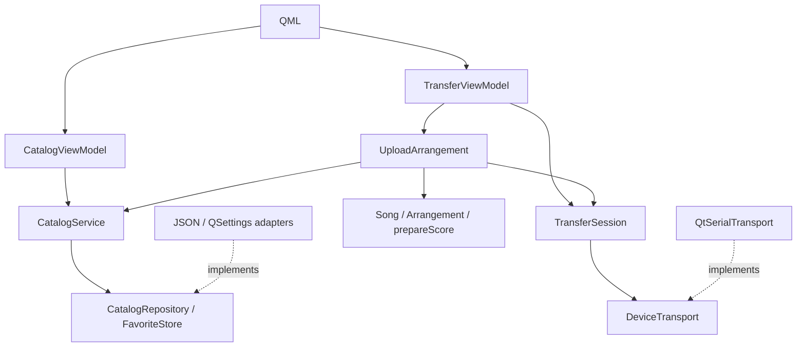

# Архитектура приложения

В приложении разделены музыкальные данные, сценарии работы, адаптеры внешних
систем и представление для Qt Quick. Точка сборки всех объектов —
[`desktop/src/main.cpp`](../desktop/src/main.cpp).

## Каталоги и зависимости

| Каталог | Ответственность | Зависимости |
|---|---|---|
| `core/domain` | Песни, аранжировки, длительность, струны, подготовка темпа | Стандартная библиотека C++, общий формат нот |
| `core/application` | Каталог, избранное, сценарий загрузки, состояние передачи, интерфейсы внешних систем | Музыкальная модель и абстрактные порты |
| `desktop/src/adapters` | JSON, QSettings, QSerialPort и таймеры транспорта | Интерфейсы ядра и Qt |
| `desktop/src/presentation` | Свойства и действия, доступные QML | Сценарии ядра и Qt Core |
| `desktop/qml` | Компоновка, оформление, отображение состояния и действия пользователя | Модели представления |

`guitar_core` — самостоятельная библиотека без Qt. Её можно собрать и проверить
с `-DGUITAR_BUILD_APP=OFF`. `guitar_desktop` добавляет Qt-адаптеры и модели
представления. Исполняемый файл `SelfGuitar` связывает их с QML и ресурсами.



## Музыкальная модель

`Song` содержит название и автора. `Arrangement` ссылается на песню через `songId`
и хранит ноты, базовый темп и описание версии. Несколько аранжировок могут
относиться к одной песне. Отображаемые цвета и значки хранятся отдельно от
музыкальных правил в метаданных каталога.

`usedStrings` и `durationMs` вычисляют характеристики аранжировки.
`prepareScore` создаёт отдельную последовательность с выбранным темпом,
сохраняя исходные ноты. Здесь нет QObject, QVariant, чтения JSON и работы с портом.

Каталог не ограничен размером памяти Uno. Проверка вместимости устройства
выполняется при передаче. Текущая модель нот по-прежнему последовательная,
с длительностью 50–10000 мс; аккорды и паузы ещё не добавлены.

## Сценарии

`CatalogService` получает данные через `CatalogRepository`, проверяет уникальность
ID, правильность нот и ссылки на песни. Избранное хранится по ID аранжировки
через `FavoriteStore`. Ошибки загрузки или сохранения доступны представлению;
неудачная перезагрузка не затирает предыдущий корректный каталог.

`UploadArrangement` находит аранжировку по ID, подготавливает последовательность
с выбранным темпом и передаёт её в `TransferSession`.

`TransferSession` — обычный C++-объект. Он отвечает за handshake, очередь нот,
ожидаемые подтверждения, CRC, прогресс, отмену и ошибки. USB-устройство подставляется
через интерфейс `DeviceTransport`, поэтому сценарий проверяется без платы.

```text
Disconnected → Connecting → Ready → Uploading → Ready
                    ошибка / отмена → Disconnected
```

`Loaded` устанавливается только после `OK END`. Неожиданный перезапуск платы,
обрыв связи или неверное подтверждение сбрасывают текущую передачу. Отмена
закрывает соединение, как в предыдущей реализации протокола.

## Qt и интерфейс

`CatalogViewModel` предоставляет QML список метаданных аранжировок, выбор,
поиск без учёта регистра, фильтр по струнам и избранное. Карточки выбираются
по стабильному ID; индексы отфильтрованного списка не используются как ID.
QVariantMap и QVariantList существуют только на этой границе с QML.

`TransferViewModel` предоставляет порты, состояние подключения, прогресс,
сообщения на русском и команды подключения/загрузки/отмены. Он передаёт
запрос на загрузку сценарию `UploadArrangement`.

В QML доступны два объекта: `catalog` и `transfer`. QML форматирует отображаемое
время и управляет компоновкой, но не разбирает JSON, не считает CRC и не формирует
команды Arduino. Изменение прогресса не пересоздаёт список песен: у каталога
и сессии отдельные уведомления.

## Владение и выполнение

`main.cpp` создаёт хранилища и транспорт раньше использующих их объектов,
а движок QML — после моделей представления. При завершении порядок обратный.
Ссылки в конструкторах — невладеющие; объекты-зависимости должны жить дольше
пользователей. Сессия отписывается от транспорта в деструкторе, а модель
передачи — от уведомлений сессии.

Сейчас все callbacks выполняются в потоке приложения. `QSerialPort` и `QTimer`
работают через цикл событий, без блокирующего ожидания ответа. Для будущего
рабочего потока потребуется явная доставка событий в поток GUI.

## Граница текущего этапа

Протокол v1 и прошивка сохранены: до 96 нот, режим DRYRUN, без управления
механикой. Буферное потоковое проигрывание, о котором договорились для Uno,
ещё не реализовано. Для него следующим этапом меняются сценарий/протокол
и прошивка; каталог и интерфейс не должны узнавать о деталях USB-пакетов.

Проверки: `catalog_domain`, `transfer_session` — без Qt и Arduino;
`qt_presentation` — настоящий QML с подставным транспортом, проверкой
поиска/фильтров, выбора по ID, избранного, сохранения настроек и загрузки.
Существующие `score_protocol` и `firmware_parser` проверяют общий формат
и обработчик команд платы.
